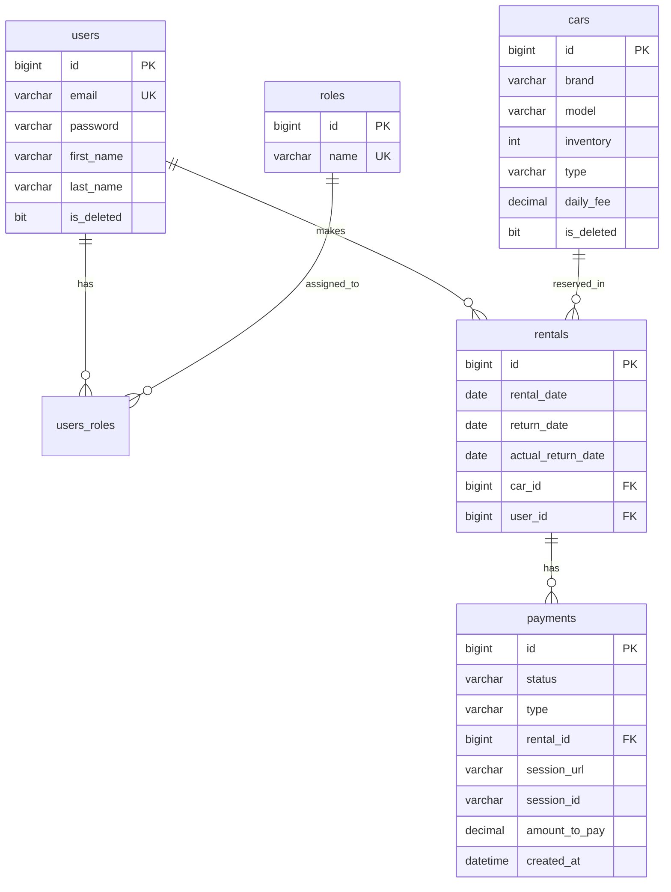

# Car sharing service backend API

This is a backend API for a car sharing service that covers full car rental life cycle from fleet inventory management and user authentication to processing Stripe payments and sending Telegram notifications.

## Technologies and Tools:
- **Language and Core:** Java 17, Spring Boot, Maven
- **Security:** Spring Security, JWT
- **Database:** Spring Data JPA, Liquibase, MySQL, Hibernate
- **Containerization:** Docker, Docker Compose
- **Code Generation:** MapStruct, Lombok
- **External Integrations:** Stripe API (`stripe-java`), Telegram Bot API
- **Testing:** Testcontainers, JUnit 5, Mockito, MockMvc
- **Documentation:** Swagger / OpenAPI (`springdoc-openapi`)

## Database Model Diagram


## Features and API Endpoints

### 1. [AuthenticationController.java](src/main/java/com/github/b1gsal/carsharingservice/controller/AuthenticationController.java)
Registration for new users and authentication using JWT tokens.

### 2. [UserController.java](src/main/java/com/github/b1gsal/carsharingservice/controller/UserController.java)
Manage authenticated user profile info (`/users/me`) and update user roles by administration (`ROLE_MANAGER`).

### 3. [CarController.java](src/main/java/com/github/b1gsal/carsharingservice/controller/CarController.java)
CRUD operations for car inventory. Public access for viewing available vehicles, full management (create, update, soft delete) reserved for managers.

### 4. [RentalController.java](src/main/java/com/github/b1gsal/carsharingservice/controller/RentalController.java)
Create car rentals (automatically decrements inventory), return rented cars (increments inventory and sets actual return date), and search rentals filtered by user ID and active status.

### 5. [PaymentController.java](src/main/java/com/github/b1gsal/carsharingservice/controller/PaymentController.java)
Stripe payment checkout session creation, payment verification (`success`/`cancel` endpoints), penalty fee calculation for overdue rentals (`FINE_MULTIPLIER`), and payment session renewal for expired payments.

### 6. Notification & Scheduler Services
- **[TelegramNotificationServiceImpl.java](src/main/java/com/github/b1gsal/carsharingservice/service/notification/TelegramNotificationServiceImpl.java)** — Real-time notification messages sent to Telegram chat on new rentals and successful payments.
- **[OverdueRentalScheduler.java](src/main/java/com/github/b1gsal/carsharingservice/scheduler/OverdueRentalScheduler.java)** — Scheduled daily check for unreturned overdue cars with Telegram alert broadcast.
- **[ExpiredPaymentScheduler.java](src/main/java/com/github/b1gsal/carsharingservice/scheduler/ExpiredPaymentScheduler.java)** — Scheduled periodic check for expired Stripe sessions to mark them as `EXPIRED`.

## Getting started

### Requirements
- Git
- JDK 17 or higher
- Docker Desktop
- Maven 3.8+

### 1. Clone the repository
```bash
git clone https://github.com/b1gsal/car-sharing-app.git
cd car-sharing-app
```

### 2. Environment Configuration
Create `.env` file from `.env.sample`:
```bash
cp .env.sample .env
```

Fill in environment variables in `.env`:
```env
MYSQLDB_USER=root
MYSQLDB_PASSWORD=root
MYSQLDB_DATABASE=car_sharing
MYSQLDB_LOCAL_PORT=3307
MYSQLDB_DOCKER_PORT=3306
MYSQLDB_ROOT_PASSWORD=root

STRIPE_SECRET_KEY=your_stripe_secret_key_here
TELEGRAM_BOT_TOKEN=your_telegram_bot_token_here
TELEGRAM_CHAT_ID=your_telegram_chat_id_here
```

### 3. Build the project
Compile the application and package it:
```bash
./mvnw clean package -DskipTests
```

### 4. Run the application

#### Option A: Run with Docker (Multi-container)
Builds application image and runs both MySQL and Spring Boot in Docker containers:
```bash
docker-compose up --build
```
- **Application URL:** `http://localhost:8080`
- **Swagger Documentation:** `http://localhost:8080/swagger-ui/index.html`
- **Health Check:** `http://localhost:8080/actuator/health`

#### Option B: Run with IDE (Local Development)
1. Run MySQL in Docker:
```bash
docker-compose up -d mysql
```
2. Launch [CarSharingServiceApplication.java](src/main/java/com/github/b1gsal/carsharingservice/CarSharingServiceApplication.java) directly from IntelliJ IDEA or run:
```bash
./mvnw spring-boot:run
```
- **Application URL:** `http://localhost:8080`
- **Swagger Documentation:** `http://localhost:8080/swagger-ui/index.html`

## Swagger Documentation
Interactive OpenAPI documentation is available while the application is running:
- `http://localhost:8080/swagger-ui/index.html`

## Challenges and Solutions
- **Stateless Security & Role Authorization:** Implemented stateless JWT authentication integrated with Spring Security to strictly enforce access rights between customers (`ROLE_CUSTOMER`) and administrators (`ROLE_MANAGER`).
- **Overdue Penalties & Payment Renewal:** Implemented automated fine calculation for late returns (`FINE_MULTIPLIER = 2`) and added an automated session tracking mechanism that allows users to renew expired Stripe checkout sessions.
- **Automated Notifications & Schedulers:** Created a dedicated Telegram notification service with `@Scheduled` cron tasks for daily overdue rental alerts and automated status synchronization for expired payments.
- **Integration Testing:** Utilized Testcontainers with a real MySQL Docker instance to ensure end-to-end reliability for all controllers and service layers.